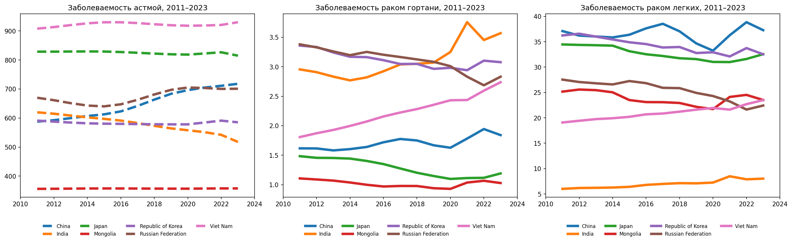

# China Industry & Environment: промышленность, экология и качество жизни в Китае (2011–2024)

## О проекте

Целью исследования было изучить общие тенденции изменения экологических показателей Китая после экологического кризиса 2013 года, который стал одним из поворотных моментов в государственной экологической политике страны.

В исследовании использованы данные за 2011–2024 годы с детализацией по 31 провинции, автономному району и городу центрального подчинения Китая.

Динамика промышленного производства и добычи природных ресурсов сопоставляется с изменениями экологических индикаторов, а также с ростом реальных доходов городского и сельского населения.

Для более широкого понимания изменений качества жизни дополнительно изучены ожидаемая продолжительность жизни, рождаемость и заболеваемость тремя заболеваниями: астмой, раком гортани и раком лёгких. Медицинские показатели Китая сравниваются с показателями шести других стран: Индии, Японии, Монголии, России, Южной Кореи и Вьетнама.

Работа выполнена как самостоятельный исследовательский проект по изучению Python, Pandas, Matplotlib и SQL. Основное внимание уделено сбору и обработке данных, выявлению закономерностей, визуализации и самостоятельной интерпретации результатов.

## Используемые инструменты

- **Python, Pandas** — загрузка, очистка, преобразование и сопоставление данных.
- **Matplotlib** — построение графиков и сравнительных визуализаций.
- **PostgreSQL, DBeaver** — хранение и обработка промышленной и экологической статистики.
- **SQL** — подготовка данных, объединение таблиц и преобразование структуры показателей.
- **Jupyter Notebook, VS Code** — проведение исследования.

## Источники данных

**National Bureau of Statistics of China (NBS)** — промышленное производство, добыча природных ресурсов, экологические показатели, располагаемые доходы населения, индексы потребительских цен и рождаемость.

https://data.stats.gov.cn/english/

**Global Burden of Disease Study 2023 (IHME)** — возраст-стандартизированная заболеваемость астмой, раком гортани и раком трахеи, бронхов и лёгких за 2011–2023 годы.

https://vizhub.healthdata.org/gbd-results/

**Global Data Lab** — ожидаемая продолжительность жизни по регионам Китая за 2011–2023 годы.

https://globaldatalab.org/shdi/table/lifexp/CHN/

## Результаты исследования

### 1. Экологический кризис 2013 года и изменение государственной политики

Отправной точкой исследования стал экологический кризис Китая, наиболее ярким проявлением которого был сильнейший смог января 2013 года.

Причины кризиса формировались на протяжении десятилетий интенсивного промышленного роста, высокой зависимости энергетики от угля и накопления экологических проблем. Однако именно события начала 2013 года привлекли особое внимание к масштабам загрязнения атмосферного воздуха.

В сентябре 2013 года Государственный совет Китая утвердил *Air Pollution Prevention and Control Action Plan* — государственную программу предотвращения и контроля загрязнения атмосферного воздуха.

Программа предусматривала модернизацию промышленных мощностей, внедрение технологий очистки выбросов, ужесточение экологических нормативов, сокращение использования устаревшего оборудования и закрытие предприятий, не соответствующих установленным требованиям.

В последующие годы были усилены механизмы экологического надзора, в том числе проверки деятельности региональных властей и предприятий.

В 2018 году был принят новый трёхлетний план *Three-Year Action Plan for Winning the Blue Sky Defense Battle*, продолживший экологические преобразования.

Таким образом, экологический кризис 2013 года стал одним из катализаторов масштабного изменения государственного регулирования промышленной и экологической деятельности Китая.

### 2. Изменение экологических показателей

В исследуемом периоде (2011–2024 годы) выявлены значительные изменения экологических индикаторов по большинству провинций Китая.

В работе рассмотрена динамика:

- выбросов диоксида серы (SO₂);
- выбросов оксидов азота (NOₓ);
- выбросов твёрдых загрязняющих частиц;
- показателей общего азота и общего фосфора;
- промышленного водопотребления и связанных с ним экологических показателей.

Наиболее выраженные изменения ряда показателей атмосферных выбросов наблюдаются после начала государственных экологических реформ.

Научные исследования подтверждают, что государственные программы 2013–2017 и 2018–2020 годов внесли существенный вклад в снижение загрязнения атмосферного воздуха. Среди основных механизмов выделяются модернизация производственного оборудования, совершенствование систем очистки выбросов, изменение структуры энергопотребления и усиление экологического контроля.

Визуализации, представленные в работе, позволяют проследить эти процессы по отдельным регионам и увидеть различия в масштабах экологических изменений.

### 3. Промышленное производство и экологическая модернизация

Одним из наиболее интересных результатов исследования стало сопоставление сокращения загрязняющих выбросов с динамикой промышленного производства.

В работе рассмотрены производство цемента, стали, чугуна, кокса, электроэнергии, стекла, автомобилей, химической продукции, пластмасс, электроники, а также добыча нефти и природного газа.

Анализ показывает, что значительное сокращение ряда промышленных выбросов происходило без сопоставимого общего сокращения промышленной деятельности.

В отдельных отраслях и провинциях наблюдались снижение производства и изменение его географического распределения. Однако в целом экологические преобразования нельзя объяснить исключительно закрытием предприятий или сокращением промышленного выпуска.

Полученные результаты демонстрируют признаки *decoupling* — разъединения динамики промышленной деятельности и экологической нагрузки.

Для меня этот результат является одним из наиболее впечатляющих достижений китайских преобразований.

Китай смог существенно улучшить ряд экологических показателей, одновременно сохраняя крупномасштабное промышленное производство и продолжая развитие отдельных отраслей экономики.

Это позволяет рассматривать экологическую модернизацию Китая как пример масштабных структурных изменений, достигнутых с помощью государственного регулирования, технического переоснащения и контроля исполнения экологических требований.

### 4. Рост реальных доходов населения

Отдельное направление исследования посвящено динамике располагаемых доходов городского и сельского населения китайских провинций.

Номинальные доходы были скорректированы на инфляцию с использованием региональных индексов потребительских цен. В качестве базового принят 2011 год.

Такой подход позволяет оценивать изменения покупательной способности населения, а не только номинальный рост денежных доходов.

В исследуемом периоде реальные доходы демонстрируют устойчивую положительную динамику.

В большинстве провинций рост оказался значительным, а во многих регионах реальные доходы увеличились в два раза и более относительно начала периода.

На мой взгляд, этот результат можно назвать своеобразным экономическим чудом Китая.

Особенно интересно, что масштабное сокращение ряда загрязняющих выбросов происходило одновременно с ростом реальных доходов населения.

Однако средние показатели доходов не позволяют оценить, насколько равномерно распределяются результаты экономического развития между различными социальными и возрастными группами.

В частности, рост доходов сам по себе не показывает изменения доступности жилья, образования, медицинской помощи и других расходов, необходимых для самостоятельной жизни и воспитания детей.

### 5. Заболеваемость и последствия длительного загрязнения окружающей среды

Для дополнительного изучения изменений состояния здоровья населения использованы данные Global Burden of Disease (GBD 2023) за 2011–2023 годы.

Рассмотрены три заболевания:

- астма;
- рак гортани;
- рак трахеи, бронхов и лёгких.

Использованы возраст-стандартизированные показатели заболеваемости, выраженные числом новых случаев на 100 тысяч человек населения.

Для понимания относительного уровня заболеваемости выполнено сравнение Китая с Индией, Японией, Монголией, Россией, Южной Кореей и Вьетнамом.

Полученные визуализации не демонстрируют столь же однозначного улучшения, какое наблюдается в отношении ряда экологических показателей.

В Китае заболеваемость астмой имеет выраженную тенденцию к росту. Показатель заболеваемости раком гортани также увеличивается в исследуемом периоде.

Заболеваемость раком лёгких остаётся высокой относительно выбранной группы стран. При этом на графике наблюдаются колебания, но отсутствует устойчивое снижение показателя.

На первый взгляд возникает противоречие: загрязнение сокращается, а заболеваемость отдельными заболеваниями органов дыхания не демонстрирует соответствующего улучшения.

Однако исследования показывают, что причины таких заболеваний значительно сложнее.

Рак лёгких может развиваться спустя десятилетия после воздействия неблагоприятных факторов. Поэтому показатели заболеваемости в 2011–2023 годах могут отражать последствия загрязнения окружающей среды предшествующих десятилетий.

Кроме того, важную роль играют курение, профессиональные воздействия и другие факторы риска.

Следовательно, сокращение промышленных выбросов не должно автоматически приводить к немедленному снижению онкологической заболеваемости.

Для сравнения полезен опыт США, где снижение распространённости курения на протяжении нескольких десятилетий сопровождалось существенным сокращением возраст-стандартизированной заболеваемости раком лёгких.

Таким образом, экологическая модернизация и снижение онкологических рисков являются взаимосвязанными, но не идентичными процессами. Их результаты могут проявляться в разные периоды времени.

### 6. Продолжительность жизни и снижение рождаемости

Для более широкого понимания изменений качества жизни населения Китая были исследованы два демографических показателя по 31 региону:

- ожидаемая продолжительность жизни за 2011–2023 годы;
- общий коэффициент рождаемости за 2011–2024 годы.

Визуализации показывают две противоположные тенденции.

**Ожидаемая продолжительность жизни увеличивается практически во всех провинциях Китая.**

Наиболее высокие показатели наблюдаются в Пекине, Шанхае и Тяньцзине, где ожидаемая продолжительность жизни превышает 80 лет.

Вместе с тем **рождаемость в большинстве регионов существенно снижается**.

В отдельных провинциях сокращение оказалось особенно выраженным. При этом изменение динамики происходило не одновременно и имело региональные особенности.

Это стало одним из наиболее интересных противоречий, обнаруженных в исследовании.

В течение рассматриваемого периода Китай добился существенных результатов в экологической модернизации, развитии промышленности, увеличении реальных доходов и продолжительности жизни населения. Однако эти достижения не сопровождались устойчивым восстановлением рождаемости.

В 2016 году страна перешла к политике двух детей, а в 2021 году — трёх детей. Несмотря на отмену прежних ограничений, нисходящая демографическая тенденция сохранилась.

На мой взгляд, это заставляет задуматься о том, насколько улучшение средних экономических показателей отражает реальные жизненные перспективы населения, особенно молодого поколения.

Увеличение доходов не обязательно означает повышение доступности жилья, образования, медицинской помощи и инфраструктуры ухода за детьми.

Рост продолжительности жизни также не показывает, насколько уверенно молодые люди оценивают возможность создания семьи и воспитания следующего поколения.

**Повышение текущего благополучия общества и создание условий для рождения и воспитания детей — взаимосвязанные, но не одинаковые задачи.**

При этом представленные данные не позволяют установить причины снижения рождаемости. Для этого потребовалось бы отдельное исследование возрастной структуры населения, репродуктивных намерений, доступности социальных услуг, стоимости жилья и других факторов.

### 7. Государственные реформы и перспективы

Экологические преобразования Китая показывают, что последовательная государственная политика может существенно изменить измеряемые показатели промышленного загрязнения.

После кризиса 2013 года экологическое регулирование стало одним из приоритетных направлений государственной политики.

В области демографии ситуация оказалась значительно сложнее.

Отмена ограничений на количество детей не привела к устойчивому восстановлению рождаемости. В последующие годы государство стало расширять меры поддержки семей, включая выплаты на детей, развитие дошкольного образования и снижение отдельных расходов на воспитание детей.

Однако долгосрочные результаты новых мер пока невозможно оценить.

На мой взгляд, опыт Китая показывает, что различные общественные проблемы требуют разных подходов к государственному регулированию.

Промышленные выбросы можно относительно быстро сократить с помощью технологических изменений, нормативных требований и контроля исполнения.

Изменение демографического поведения населения имеет более сложную природу и связано не только с действующим законодательством, но и с условиями жизни, социальной инфраструктурой и ожиданиями людей относительно собственного будущего.

## Основные выводы

Главный результат исследования заключается в том, что экологический кризис, наиболее ярко проявившийся в январе 2013 года, стал важным катализатором изменения государственной экологической политики Китая.

За последующее десятилетие страна достигла значительных результатов в сокращении ряда промышленных выбросов.

При этом экологическая модернизация происходила на фоне сохранения масштабной промышленной деятельности и устойчивого роста реальных доходов населения.

Визуализации позволяют проследить эти изменения по 31 региону Китая, обнаружить общие тенденции и региональные различия.

Однако улучшение экологических и экономических показателей не сопровождалось столь же однозначными положительными изменениями в медицинской и демографической статистике.

Ожидаемая продолжительность жизни увеличилась, но заболеваемость отдельными заболеваниями органов дыхания не продемонстрировала устойчивого снижения, а рождаемость продолжила сокращаться.

Это позволяет предположить, что последствия многолетнего загрязнения окружающей среды и социально-экономических преобразований имеют более длительный и сложный характер, чем изменения непосредственно измеряемых промышленных показателей.

**Десяти лет оказалось достаточно, чтобы увидеть масштабные результаты экологической модернизации, но недостаточно, чтобы наблюдать сопоставимое улучшение всех медицинских и демографических показателей.**

На момент завершения исследования можно говорить о положительной динамике ряда экологических и экономических индикаторов и значительных результатах государственной экологической политики Китая.

Однако улучшение измеряемых показателей благополучия ещё не означает, что все проблемы качества жизни населения решены.

Для меня наиболее интересным результатом стало именно это противоречие: **страна может значительно улучшить экологическую ситуацию, увеличить реальные доходы и продолжительность жизни населения, но при этом продолжать сталкиваться с серьёзными демографическими проблемами.**

Этот результат показывает, что экономический прогресс и общественное благополучие — более сложные понятия, чем рост производства, денежных доходов или продолжительности жизни по отдельности.

## Ограничения исследования

Работа носит преимущественно описательный характер и выполнена как самостоятельный учебный проект по анализу данных.

**Различия во временных периодах.** Основные показатели промышленности, экологии и доходов охватывают 2011–2024 годы. Медицинские данные и продолжительность жизни представлены за 2011–2023 годы.

**Различия в территориальной детализации.** Промышленная, экологическая и демографическая статистика анализируется по 31 региону Китая. Медицинские показатели GBD использованы на общенациональном уровне. Поэтому прямой анализ связи между заболеваемостью и выбросами отдельных провинций не проводился.

**Особенности медицинской статистики.** Данные GBD являются модельными оценками и содержат интервалы неопределённости. Изменения отдельных лет, в том числе в период пандемии COVID-19, требуют дополнительной интерпретации.

**Особенности показателей продолжительности жизни.** Оценки Global Data Lab рассчитываются с использованием региональных и национальных данных. Синхронные изменения показателей по отдельным годам могут быть связаны как с реальной динамикой смертности, так и с особенностями методологии расчёта.

**Различие экологических показателей.** Промышленные выбросы, концентрации загрязняющих веществ в атмосферном воздухе и использование водных ресурсов характеризуют разные процессы. Изменение одного показателя не означает пропорционального изменения остальных.

**Корректировка доходов на инфляцию.** Региональные индексы потребительских цен позволяют оценивать изменения реальных доходов, но не отражают полностью различия стоимости жилья, образования и других расходов между социальными группами.

**Отсутствие причинно-следственной модели.** Обнаруженные совпадения и расхождения тенденций не доказывают причинную связь между экологическими реформами, доходами, заболеваемостью и рождаемостью.

**Международное сравнение.** Семь выбранных стран позволяют оценить относительное положение Китая по трём заболеваниям, но не представляют все страны Азии или мира.

Перечисленные ограничения определяют границы выводов, которые можно сделать на основании использованных данных.

## Источники и литература

### Статистические данные

1. **National Bureau of Statistics of China (NBS).** Промышленность, экология, доходы, CPI, рождаемость.  
   https://data.stats.gov.cn/english/

2. **Institute for Health Metrics and Evaluation (IHME). Global Burden of Disease Study 2023.** Данные о заболеваемости.  
   https://vizhub.healthdata.org/gbd-results/

3. **Global Data Lab. Subnational HDI — Life Expectancy.** Продолжительность жизни по регионам Китая.  
   https://globaldatalab.org/shdi/table/lifexp/CHN/

### Государственные программы

4. **State Council of China (2013).** *Air Pollution Prevention and Control Action Plan.*  
   https://www.oecd.org/content/dam/oecd/en/publications/reports/2020/03/policies-regulatory-framework-and-enforcement-for-air-quality-management-the-case-of-china_45a49c01/7d1d1a82-en.pdf

5. **State Council of China (2018).** *Three-Year Action Plan for Winning the Blue Sky Defense Battle.*  
   https://english.www.gov.cn/policies/latest_releases/2018/07/03/content_281476207708632.htm

### Научные исследования

6. **Zheng B. et al. (2018).** *Trends in China's anthropogenic emissions since 2010 as the consequence of clean air actions.* Atmospheric Chemistry and Physics.  
   https://acp.copernicus.org/articles/18/14095/2018/

7. **Zhang Q. et al. (2019).** *Drivers of improved PM₂.₅ air quality in China from 2013 to 2017.* Proceedings of the National Academy of Sciences.  
   https://pmc.ncbi.nlm.nih.gov/articles/PMC6900509/

8. **Nature Geoscience (2024).** *Efficacy of China’s clean air actions to tackle PM₂.₅ pollution between 2013 and 2020.*  
   https://www.nature.com/articles/s41561-024-01540-z

9. **Trends in lung cancer burden, risk factors, and disease projections in China and the United States, 1990–2023 (2026).** Исследование на основе GBD 2023.  
   https://pmc.ncbi.nlm.nih.gov/articles/PMC13649619/

10. **Health Policy and Planning (2024).** *The effect of gradually lifting the two-child policy on demographic changes in China.*  
    https://academic.oup.com/heapol/article/39/4/363/7604365

11. **BMJ (2024).** *How can China tackle its declining fertility rate?*  
    https://www.bmj.com/content/386/bmj-2023-078635

---

**Тип проекта:** самостоятельное исследование открытых данных.

**Период:** 2011–2024 годы (в зависимости от доступности отдельных показателей).

**География:** 31 регион Китая; для медицинского сравнения — семь стран.

**Основные технологии:** Python, Pandas, Matplotlib, PostgreSQL, SQL, DBeaver.

## Структура проекта

Проект состоит из нескольких папок:

- **data/raw** — исходные статистические данные Китая и медицинские показатели.
- **data/processed** — подготовленные данные для анализа в Python.
- **data/metadata** — сведения о количестве записей в таблицах базы данных.
- **sql** — SQL-скрипты для подготовки и объединения данных в PostgreSQL.
- **notebooks** — Jupyter Notebook с анализом данных и построением графиков.
- **figures** — графики, представленные в отчёте.

Основной SQL-скрипт — `china_data_analysis.sql`.

Анализ и визуализация выполнены в `china_industry_ecology_visualization.ipynb`.